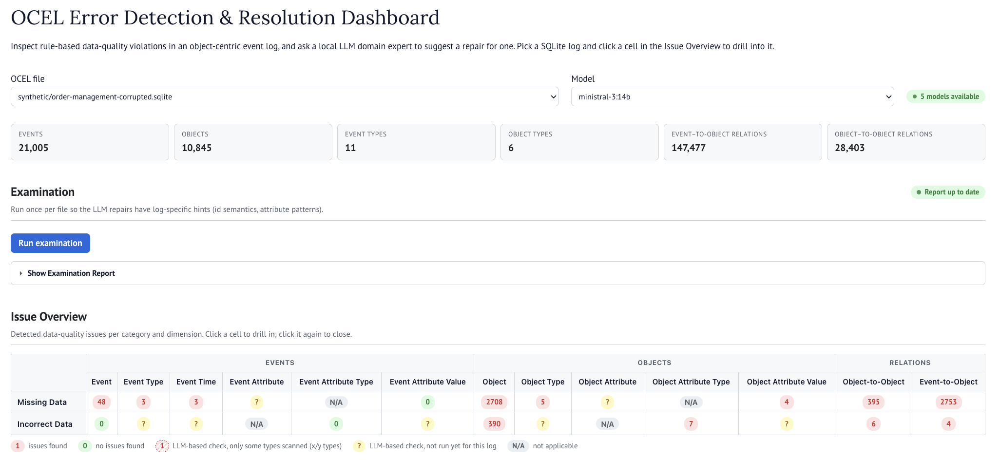
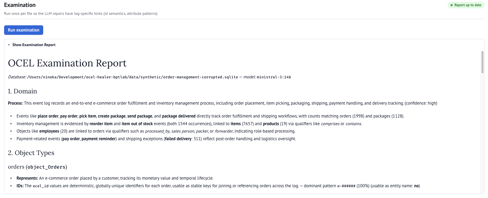
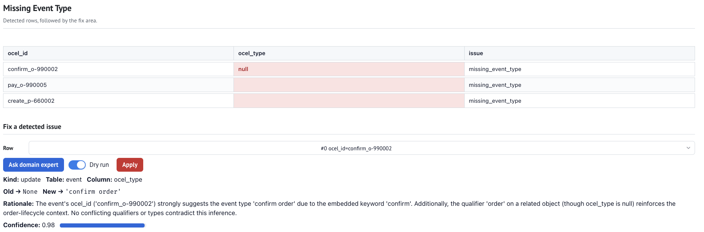
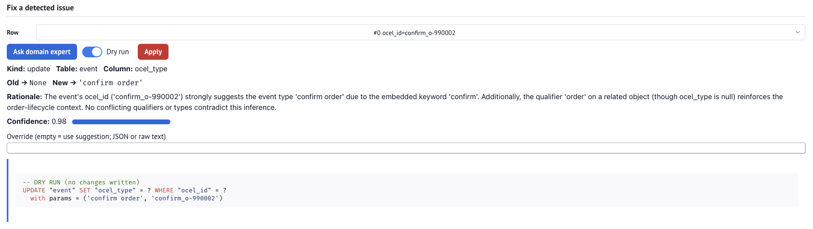

# OCEL Healer

Detection and LLM-assisted repair of data-quality issues in object-centric event logs

OCEL Healer combines four steps:

1. **Rule-based detection** finds data-quality issues deterministically (missing values, duplicates, dangling relations, wrong attribute types, …). No LLM is needed for this.
2. **Examination** profiles the log once (id patterns, value vocabularies, null rates, …) and lets the LLM turn the profile into a short guide. Both are used in the next two steps as hints specific to that log.
3. **LLM-based detection** covers issues that need domain judgement: an object or event assigned to the wrong type, an implausible timestamp or attribute value, an attribute a type should have but does not. An LLM served by [Ollama](https://ollama.com) judges the candidate rows of a chosen type and flags suspects; the user confirms or dismisses each flag before it counts as detected.
4. **LLM-based repair** asks the LLM to propose a fix for each detected issue, whether it came from the rules or from the LLM. Proposals are shown with their confidence before anything is written.

You can connect any model served by [Ollama](https://ollama.com), on this machine or on a server you choose (see [Setting up the LLM](#setting-up-the-llm-ollama)).

## Contents

- [A short tour](#a-short-tour)
- [Installation](#installation)
- [Quick start: the dashboard](#quick-start-the-dashboard)
- [Setting up the LLM (Ollama)](#setting-up-the-llm-ollama)
- [Pipeline components](#pipeline-components)
- [Data](#data)
- [Repository structure](#repository-structure)
- [Requirements](#requirements)
- [Troubleshooting](#troubleshooting)
- [License](#license)

## A short tour

The screenshots below follow one issue through the dashboard, on the bundled synthetic log `data/synthetic/order-management-corrupted.sqlite` with the model `ministral-3:14b`.

**1. Open a log.** The dashboard shows a few log statistics and the *Issue Overview*: the number of detected issues per category (missing or incorrect data) and per element of the log (events, objects, relations). Red numbers are issues the rule-based detectors found. A yellow **?** marks an LLM-based check that has not been run on this log yet.



**2. Examine the log once.** *Run examination* profiles the log and asks the LLM to describe it. The report is saved next to the log and gives the LLM steps context such as the process, the object types and typical values.



**3. Drill into an issue and ask for a repair.** Clicking *Missing Data / Event Type* lists three events without a type. For the first one, *Ask domain expert* proposes the type `confirm order`. It explains why, based on the event id and the order the event is linked to, and gives its confidence.



**4. Check the change, then apply it.** With *Dry run* on, *Apply* only shows the SQL it would run. Switch *Dry run* off and press *Apply* again to write the change to the log.



## Installation

### 1. Clone the repository with its data

Install Git LFS once per machine (`git lfs install`), then clone:

```bash
git clone https://github.com/bptlab/ocel-healer.git
cd ocel-healer
```

This downloads **all** datasets (~3 GB, mostly the real-world logs). If you only want the small synthetic logs:

```bash
GIT_LFS_SKIP_SMUDGE=1 git clone https://github.com/bptlab/ocel-healer.git
cd ocel-healer
git lfs pull --include="data/synthetic/*"
# later, if needed: git lfs pull
```

On Windows PowerShell, replace the first line with `$env:GIT_LFS_SKIP_SMUDGE=1; git clone https://github.com/bptlab/ocel-healer.git`.

### 2. Create a virtual environment and install

macOS / Linux:

```bash
python3 -m venv .venv
source .venv/bin/activate
pip install -r requirements.txt
```

Windows (PowerShell):

```powershell
py -m venv .venv
.venv\Scripts\Activate.ps1
pip install -r requirements.txt
```

This installs the project in editable mode (`-e .`) along with its dependencies. All commands below assume the environment is active and you are in the repository root.

### 3. Check the installation (optional)

```bash
pip install -e ".[dev]"
pytest
```

## Quick start: the dashboard

```bash
marimo run src/dashboard.py
```

The dashboard opens in your browser (use `marimo edit src/dashboard.py` to also see and edit the code cells).

- **Pick a log** from the *OCEL File* dropdown. It lists every `*.sqlite` under `data/` and preselects `data/synthetic/order-management-corrupted.sqlite`, a log with known, injected issues.
- **Rule-based detection** runs immediately, with or without an LLM.
- **Click a cell in the Issue Overview** to drill into that issue; click it again to close the drill-in.
- **LLM features** (examination, LLM-based detection, repair suggestions) become available once Ollama is running and at least one model is pulled (next section). Pick the model in the *Model* dropdown. Overview cells that need the LLM show a yellow **?** badge until you click them, pick a type and click *Run detection*; flags you confirm are then counted in the Overview.
- **Long LLM steps can be stopped.** While examination, an LLM detection run or *Ask domain expert* is running, a progress line with an **Abort** button is shown. Aborting stops at once, including the request the model is working on. An aborted detection run keeps the verdicts it already has; an aborted examination keeps the previous report. Only one LLM step runs at a time.

> **Applying a repair modifies the selected `.sqlite` file in place.** To restore a bundled log, run `git checkout -- data/<path>.sqlite`. To keep the originals untouched, copy a log into `data/` under a new name and work on the copy.

## Setting up the LLM (Ollama)

### 1. Install Ollama

| OS | Install |
| --- | --- |
| macOS | Download the app from [ollama.com/download](https://ollama.com/download), or `brew install ollama` |
| Linux | `curl -fsSL https://ollama.com/install.sh \| sh` |
| Windows | Download the installer from [ollama.com/download](https://ollama.com/download) |

### 2. Start the server

The desktop app (macOS/Windows) and the Linux install script start the server in the background. Otherwise run `ollama serve` in a separate terminal and leave it open. Either way it listens on `http://localhost:11434`.

### 3. Pull a model

```bash
ollama pull qwen3:8b      # the default model (~5 GB)
ollama list               # check what is available
```

**Any model served by Ollama can be used.** The dashboard lists every pulled model in its *Model* dropdown. For the command-line tools, pass `--model <name>` or set `OCEL_LLM_MODEL`. Notes on choosing a model:

- The model must return JSON. Ollama's JSON mode is requested automatically, so most instruction-tuned models work.
- Each repair call has a 60 s timeout and each examination step 180 s. On slow hardware, or with "thinking"/reasoning models that produce long outputs, these can be exceeded. In that case pick a smaller or non-reasoning model.
- Use the model's exact Ollama name including the tag (e.g. `qwen3:8b`, not `qwen3`).

### 4. Configuration (environment variables)

| Variable | Default | Purpose |
| --- | --- | --- |
| `OCEL_LLM_MODEL` | `qwen3:8b` | Default model for `python -m src.examination` and other library calls. The dashboard uses its *Model* dropdown instead. |
| `OLLAMA_HOST` | `http://localhost:11434` | Ollama server to use, e.g. one running on another machine. |
| `OCEL_LLM_MIN_CONFIDENCE` | `0.4` | Repairs whose LLM confidence is below this threshold are not applied (lower → more, riskier repairs). |

Set them in the shell before launching a tool:

```bash
export OLLAMA_HOST=http://my-gpu-box:11434          # macOS / Linux
$env:OLLAMA_HOST = "http://my-gpu-box:11434"        # Windows PowerShell
```

When the dashboard reaches the server it shows **"✅ LLMs reachable — N model(s) available."** Otherwise it shows a warning. In that case check that Ollama is running and that `OLLAMA_HOST` is correct.

## Pipeline components

The dashboard ties the steps together, but each one can also be used on its own.

### Detection

```python
from src.detection.error_detection import detect_all

results = detect_all("data/synthetic/order-management-corrupted.sqlite")
# {issue_key: polars.DataFrame of affected rows}, one entry per detector
```

### Corruption (building the synthetic test log)

`src/order_management_corruption/` injects known issues into the clean Order Management log. [`src/intro.ipynb`](src/intro.ipynb) walks through it and runs the full detector sweep. Open it in Jupyter (`jupyter lab src/intro.ipynb`) or in VS Code.

```python
from src.order_management_corruption import corrupt_database, DEFAULT_CLEAN_PATH

corrupt_database(DEFAULT_CLEAN_PATH, level="all")   # levels: legacy, easy, medium, hard, all
```

With `level="all"` this regenerates `data/synthetic/order-management-corrupted.sqlite`.

### Examination

Before the LLM steps run on a log, the examination step analyses it and produces knowledge that LLM detection and LLM repair receive as `examination_hints`. It consists of a deterministic profile (schemas, null rates, id templates, value vocabularies, qualifier anomalies) and an LLM-written interpretation guide.

Run it from the dashboard (pick a log and a model, press *Run examination*) or from the command line:

```bash
python -m src.examination data/synthetic/order-management-corrupted.sqlite --model qwen3:8b
```

The artifacts are written **next to the log**, in `<log folder>/examination/<log name>/`. For the example above that is `data/synthetic/examination/order-management-corrupted/`:

- `examination_report.md`: human-readable summary (also shown in the dashboard)
- `examination_profile.json`: deterministic facts, the source of truth for hints
- `examination_guide.json`: LLM interpretations (optional layer)

The dashboard, the CLI and the LLM detection and repair steps all use this location, so a report created by any of them is picked up by the others. Repair also works without a report, just without log-specific hints. If the log's structure changes (tables, types, qualifiers), the report is marked stale and should be regenerated.

### Evaluating the examination hints

```bash
python -m src.evaluation.evaluate_hints --model qwen3:8b
python -m src.evaluation.summarize_runs
```

`evaluate_hints` measures whether the hints improve repair accuracy. It copies the clean log, injects missing attribute values with known ground truth (currently the `missing_attribute_value` issue type), runs examination, and repairs every detected violation twice: with and without hints. Both arms are scored against the ground truth (coverage, exact match, within 10 % for numbers, mean relative error, mean confidence).

Each run is archived in `data/evaluation/runs/<timestamp>-<model>/`. `summarize_runs` aggregates all runs into `data/evaluation/summary.md`.

### Pre-computed results

[`evaluation_results/`](evaluation_results/) contains the results of our evaluation runs:

- `synthetic_report.md`, `synthetic_results.csv`, `synthetic_run_outputs.json`: detection and repair on the synthetic log
- `real_world_report.md`, `real_world_results.csv`: rule-based detection on the real-world logs

## Data

All logs are OCEL 2.0 SQLite files, stored with Git LFS. They are datasets published by other authors and are **not** covered by the MIT license of the code. Each one keeps its own license; please cite the original authors when you use them.

| File in `data/` | Original dataset | Authors | License |
| --- | --- | --- | --- |
| `synthetic/order-management-baseline.sqlite` | Order Management Object-centric Event Log in OCEL 2.0 Standard, [doi:10.5281/zenodo.8337464](https://doi.org/10.5281/zenodo.8337464) | Knopp, van der Aalst (2023) | CC BY 4.0 |
| `synthetic/order-management-corrupted.sqlite` | Derived from the log above, with injected issues (see [Corruption](#corruption-building-the-synthetic-test-log)) | | CC BY 4.0 |
| `synthetic/p2p.sqlite` | Procure-To-Payment (P2P) Object-centric Event Log in OCEL 2.0 Standard, [doi:10.5281/zenodo.8412920](https://doi.org/10.5281/zenodo.8412920) | Park, Tacke genannt Unterberg (2023) | CC BY 4.0 |
| `real-world/age-of-empires.sqlite` | Object-Centric Event Log for Age of Empires Game Interactions, [doi:10.5281/zenodo.13365584](https://doi.org/10.5281/zenodo.13365584) | Liss, Elbert, Flath, van der Aalst (2024) | CC BY 4.0 |
| `real-world/angular-github-commits.sqlite` | Angular GitHub Commits Object-centric Event Log, [doi:10.5281/zenodo.8430332](https://doi.org/10.5281/zenodo.8430332) | Pegoraro (2023) | CC BY 4.0 |
| `real-world/blockchain.sqlite` | Comprehensive Ethereum Execution Data for Object-Centric Process Mining of Decentralized Applications (DApps), [doi:10.5281/zenodo.21989580](https://doi.org/10.5281/zenodo.21989580) ¹ | Berti (2026) | CC BY 4.0 |
| `real-world/enron-all-mails.sqlite` | Object-Centric Event Log (OCEL) of the Enron Email Dataset, [doi:10.5281/zenodo.21989732](https://doi.org/10.5281/zenodo.21989732) | Berti (2026) | CC BY 4.0 |
| `real-world/period20-procedure-steps.sqlite` | Object-Centric and Traditional Event Data of the German Bundestag, [doi:10.5281/zenodo.16811928](https://doi.org/10.5281/zenodo.16811928) ² | Diers, Peeva, Rennert, van der Aalst (2025) | CC BY 4.0 |
| `real-world/reasoning-benchmark.sqlite` | PMLRM-Bench: An Object-Centric Event Log of Large Reasoning Model Reasoning Steps for Process Mining Analysis, [doi:10.5281/zenodo.21977680](https://doi.org/10.5281/zenodo.21977680) | Berti (2026) | CC BY 4.0 |
| `real-world/wil-m-p-van-der-aalst.sqlite` | Object-Centric Event Logs based on Publication Data, [doi:10.5281/zenodo.23257441](https://doi.org/10.5281/zenodo.23257441) | Küsters, Pitsch, Rennert, Peeva (2026) | none stated ³ |

¹ The version of 2026-08-18. A corrected and much larger version was published on 2026-11-20 ([doi:10.5281/zenodo.24388223](https://doi.org/10.5281/zenodo.24388223)); the earlier one misses a large part of the extracted blockchain operations.<br>
² Source of the underlying data: Deutscher Bundestag/Bundesrat – DIP.<br>
³ The authors do not state a license for this dataset. Contact them before reusing it outside this repository.

**Changes to the published files.** `order-management-corrupted.sqlite` is a fixed demo snapshot with injected issues; the screenshots refer to it. The corruption generator is meant for experiments, and its output can differ from the snapshot as the injectors evolve. With `level="all"` it overwrites the snapshot; restore it with `git checkout -- data/synthetic/order-management-corrupted.sqlite`. The real-world logs other than `age-of-empires.sqlite` are not byte-identical to the published files: they were converted to OCEL 2.0 SQLite or exported from a different version, so object and event counts can differ from the numbers given by the authors.

**Using your own log:** put any OCEL 2.0 SQLite file (`.sqlite`) anywhere under `data/` and it appears in the dashboard's *OCEL File* dropdown. Logs in other formats (JSON/XML) can be converted with [pm4py](https://processintelligence.solutions/pm4py) (`pm4py.read_ocel2(...)` followed by `pm4py.write_ocel2(..., "log.sqlite")`). pm4py is not a dependency of OCEL Healer; install it separately with `pip install pm4py` (it is licensed under AGPL-3.0).

## Repository structure

```
src/
  detection/                   rule-based detectors (detect_all)
  examination/                 examination: profiling + LLM guide → hints
  llm/                         LLM client, per-issue repair tasks, repair application
  order_management_corruption/ issue injectors used to build the synthetic log
  evaluation/                  hint evaluation (evaluate_hints, summarize_runs)
  dashboard.py                 marimo dashboard
  dashboard_render.py          dashboard rendering helpers
  intro.ipynb                  walkthrough: corruption + detection
data/
  synthetic/  real-world/      OCEL 2.0 logs (Git LFS)
evaluation_results/            pre-computed evaluation results
tests/                         pytest tests
```

## Requirements

| What | Needed for | Notes |
| --- | --- | --- |
| Python ≥ 3.11 | everything | Developed and tested on macOS with Python 3.14. |
| [Git LFS](https://git-lfs.com) | the datasets | Without it, `data/**/*.sqlite` are small pointer files, not databases. |
| ~3.5 GB disk | all datasets | Synthetic logs only: ~35 MB (see [Installation](#installation)). |
| [Ollama](https://ollama.com) + one model | LLM detection, repair, examination, evaluation | Optional: rule-based detection works without it. An 8B model needs ~5 GB disk and ~8 GB RAM. |

## Troubleshooting

| Symptom | Fix |
| --- | --- |
| `sqlite3.DatabaseError: file is not a database` | The log is an LFS pointer. Install Git LFS and run `git lfs pull`. |
| Dashboard: "LLMs not reachable" | Start Ollama (app or `ollama serve`). Check `OLLAMA_HOST`. |
| *Model* dropdown shows `(none)` | No model pulled yet: `ollama pull qwen3:8b` (or any other model). |
| Repair or examination times out | Use a smaller or non-reasoning model, or a faster machine via `OLLAMA_HOST`. |
| A bundled log was changed by *Apply* | `git checkout -- data/<path>.sqlite` |
| `ModuleNotFoundError: No module named 'src'` | Run commands from the repository root with the virtual environment active. |

## License

The code is released under the [MIT License](LICENSE). The event logs in `data/` are datasets by other authors under their own licenses; see [Data](#data).
